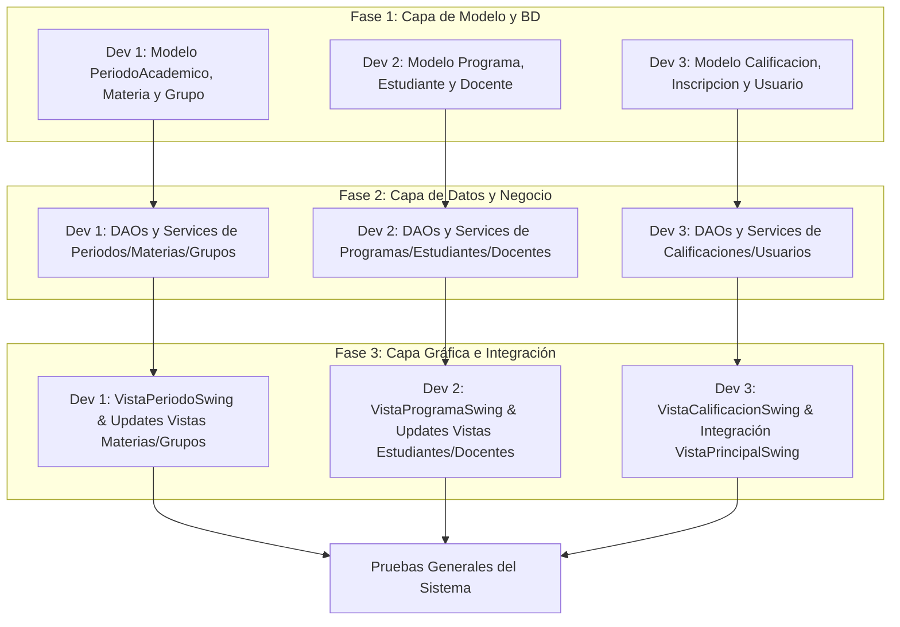

# 📋 Plan de División de Trabajo en Equipo (3 Desarrolladores)
## Sistema de Gestión Académica MVC - UNIAJC

Este documento detalla la distribución equilibrada de tareas para un equipo de **3 desarrolladores**. Cada integrante es responsable del ciclo de desarrollo completo (**Modelo, DAO, Servicio, Controlador y Vista Swing**) de sus módulos asignados.

---

## 👥 Resumen de Asignación

| Integrante | Módulo Principal | Nuevas Entidades | Entidades a Actualizar | Responsabilidad Transversal |
| :--- | :--- | :--- | :--- | :--- |
| **Desarrollador 1** | **Oferta Académica & Calendario** | `periodos_academicos` | `materias`, `grupos` | Filtros por periodo lectivo en grupos |
| **Desarrollador 2** | **Comunidad Académica & Programas** | `programas` | `estudiantes`, `docentes` | Validaciones de documentos y datos de contacto |
| **Desarrollador 3** | **Evaluación, Registro & Acceso** | `calificaciones` | `inscripciones`, `usuarios` | Menú principal y cálculo de notas finales |

> ⚠️ **Nota Importante:** En la tabla `estudiantes` **NO** se incluye el campo `codigo_estudiantil` según lo indicado. Los campos a incorporar son: `tipo_documento`, `documento`, `telefono`, `semestre_actual` y `estado`.

---

## 🛠️ Detalle de Tareas por Desarrollador

---

### 👤 DESARROLLADOR 1: Módulo de Oferta Académica y Periodos

#### 1. Nueva Entidad: `PeriodoAcademico` (`periodos_academicos`)
* **Modelo:** `com.uniajc.modelo.PeriodoAcademico`
  * Campos: `id`, `codigo` (ej. "2026-1"), `fechaInicio`, `fechaFin`, `activo`.
* **DAO:** `com.uniajc.dao.PeriodoAcademicoDao`
  * `guardar(PeriodoAcademico periodo)`
  * `obtenerTodos()`, `buscarPorId(int id)`, `obtenerPeriodoActivo()`
  * `actualizar(PeriodoAcademico periodo)`, `eliminar(int id)`
* **Servicio:** `com.uniajc.servicios.PeriodoAcademicoService`
  * Validar fechas (fecha inicio anterior a fecha fin).
  * Garantizar unicidad del código del periodo.
  * Lógica para activar un periodo y desactivar los anteriores.
* **Controlador:** `com.uniajc.controlador.ControladorPeriodoAcademico`
* **Vista:** `com.uniajc.vista.VistaPeriodoSwing` (Formulario CRUD y tabla con estado activo).

#### 2. Actualización: `materias` (Campos nuevos: `codigo`, `horas_semanales`)
* **Modelo:** Actualizar `Materia.java` agregando `codigo` y `horasSemanales`.
* **DAO:** Actualizar `MateriaDao.java` (INSERT, SELECT, UPDATE y mapeo de `codigo` y `horas_semanales`).
* **Servicio:** Actualizar `MateriaService.java` (Validar que `codigo` no esté duplicado y `horasSemanales > 0`).
* **Controlador & Vista:** Actualizar `ControladorMateria.java` y `VistaMateriaSwing.java` para incluir columnas y campos de texto de código y horas semanales.

#### 3. Actualización: `grupos` (Campos nuevos: `cupo_maximo`, `periodo`)
* **Modelo:** Actualizar `Grupo.java` con `cupoMaximo` y `periodo`.
* **DAO:** Actualizar `GrupoDao.java` (Mapear `cupo_maximo` y `periodo`, agregar filtro `buscarPorPeriodo(String periodo)`).
* **Servicio:** Actualizar `GrupoService.java` (Validar cupo positivo y periodo válido).
* **Controlador & Vista:** Actualizar `ControladorGrupo.java` y `VistaGrupoSwing.java` con los nuevos campos en la tabla y formulario.

---

### 👤 DESARROLLADOR 2: Módulo de Comunidad Académica y Programas

#### 1. Nueva Entidad: `Programa` (`programas`)
* **Modelo:** `com.uniajc.modelo.Programa`
  * Campos: `id`, `codigo` (ej. "ING-SIS"), `nombre`, `facultad`, `duracionSemestres`.
* **DAO:** `com.uniajc.dao.ProgramaDao`
  * `guardar(Programa programa)`
  * `obtenerTodos()`, `buscarPorId(int id)`, `buscarPorCodigo(String codigo)`
  * `actualizar(Programa programa)`, `eliminar(int id)`
* **Servicio:** `com.uniajc.servicios.ProgramaService`
  * Validar que el código no exista previamente.
  * Validar duración de semestres entre 1 y 12.
* **Controlador:** `com.uniajc.controlador.ControladorPrograma`
* **Vista:** `com.uniajc.vista.VistaProgramaSwing` (CRUD con tabla de carreras y facultades).

#### 2. Actualización: `estudiantes` (Campos nuevos: `tipo_documento`, `documento`, `telefono`, `semestre_actual`, `estado`)
* **Modelo:** Actualizar `Estudiante.java` (Agregar `tipoDocumento`, `documento`, `telefono`, `semestreActual`, `estado`).
* **DAO:** Actualizar `EstudianteDao.java`
  * Modificar consultas SQL para leer y escribir los nuevos campos.
  * Agregar método `buscarPorDocumento(String documento)`.
* **Servicio:** Actualizar `EstudianteService.java`
  * Validar formato de documento y teléfono.
  * Validar que el documento sea único.
  * Validar que `semestreActual >= 1`.
* **Controlador & Vista:** Actualizar `ControladorEstudiante.java` y `VistaEstudianteSwing.java` (Añadir selectores de Tipo Documento, campos de texto y filtros por Estado).

#### 3. Actualización: `docentes` (Campos nuevos: `documento`, `email`, `telefono`, `titulo_academico`, `tipo_contrato`)
* **Modelo:** Actualizar `Docente.java` (Agregar los 5 nuevos atributos).
* **DAO:** Actualizar `DocenteDao.java` (Ajustar INSERT, UPDATE, SELECT y mapeo ResultSet).
* **Servicio:** Actualizar `DocenteService.java` (Validar email corporativo y unicidad de documento).
* **Controlador & Vista:** Actualizar `ControladorDocente.java` y `VistaDocenteSwing.java` (Formulario con desplegables para título académico y tipo de contrato).

---

### 👤 DESARROLLADOR 3: Módulo de Evaluación, Inscripciones y Seguridad

#### 1. Nueva Entidad: `Calificacion` (`calificaciones`)
* **Modelo:** `com.uniajc.modelo.Calificacion`
  * Campos: `id`, `inscripcionId`, `corte` ("Corte 1", "Corte 2", etc.), `porcentaje`, `nota`, `observacion`.
* **DAO:** `com.uniajc.dao.CalificacionDao`
  * `guardar(Calificacion calificacion)`
  * `obtenerPorInscripcion(int inscripcionId)`
  * `actualizar(Calificacion calificacion)`, `eliminar(int id)`
* **Servicio:** `com.uniajc.servicios.CalificacionService`
  * Validar rango de notas: `0.0 <= nota <= 5.0`.
  * Validar que la sumatoria de porcentajes de un estudiante en un curso no exceda el `100.0%`.
  * Actualizar automáticamente la `nota_final` en la tabla `inscripciones` al registrar o editar un corte.
* **Controlador:** `com.uniajc.controlador.ControladorCalificacion`
* **Vista:** `com.uniajc.vista.VistaCalificacionSwing` (Gestión de notas por corte para cada estudiante inscrito).

#### 2. Actualización: `inscripciones`
* **DAO & Servicio:** Actualizar `InscripcionCursoDao.java` y `InscripcionCursoService.java`
  * Conectar el recalculo de `nota_final` y actualizar el `estado` (Aprobado / Reprobado / En Curso) según el promedio ponderado.
* **Vista:** Actualizar `VistaInscripcionSwing.java` para mostrar el botón "Ver / Asignar Calificaciones".

#### 3. Actualización: `usuarios` y Navegación Global
* **Modelo:** Actualizar `Usuario.java` agregando `email` y `ultimoAcceso`.
* **DAO & Servicio:** Actualizar `UsuarioDao.java` y `UsuarioService.java` para persistir `email` y actualizar `ultimo_acceso = NOW()` al autenticar.
* **Vista Principal:** Actualizar `VistaPrincipalSwing.java` incorporando en el menú de "Módulos":
  * 🔘 Periodos Académicos (Desarrollador 1)
  * 🔘 Programas Académicos (Desarrollador 2)
  * 🔘 Calificaciones y Notas (Desarrollador 3)

---

## 📅 Matriz de Entregables y Orden de Implementación Sugerido

---

## 💡 Recomendaciones para el Trabajo en Git

1. **Ramas independientes:** Cada integrante debe trabajar en su propia rama de Git:
   * `feature/oferta-academica-periodos` (Desarrollador 1)
   * `feature/comunidad-programas` (Desarrollador 2)
   * `feature/calificaciones-seguridad` (Desarrollador 3)
2. **Convención de commits:** Usar mensajes claros como `feat(modelo): agrega clase PeriodoAcademico` o `fix(dao): mapeo de nuevos campos en EstudianteDao`.
3. **Compilación antes de merge:** Ejecutar siempre `mvn clean compile` y `mvn test` antes de enviar cambios al repositorio.

